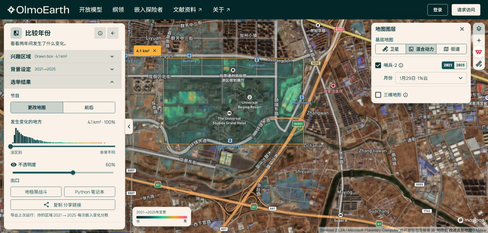
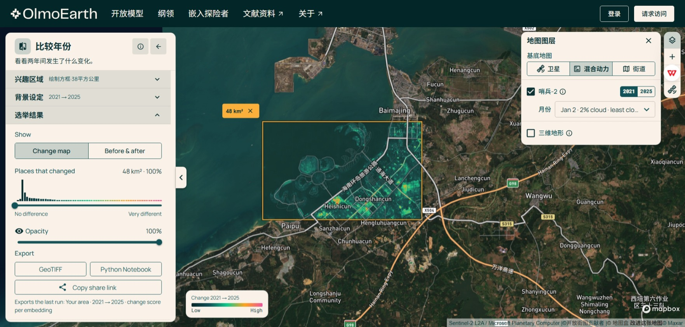

# Tourism Embedding Change Screening

Reproduction materials for **Democratizing Tourism Land Use Monitoring: An Exploratory Proof of Concept Using Precomputed Earth Embeddings**.

**Author:** Lei Shao  
Department of Tourism Management, Business School, Tianjin University of Finance and Economics, Tianjin, China.

## Overview

This exploratory research note applies OlmoEarth v1.3 annual embeddings to surface-change screening around Universal Beijing Resort and Ocean Flower Island, Hainan. Both cases compare 2021 and 2025 using the first 64 embedding dimensions on a 10 m grid. No task-specific labels or fine-tuning are used.

Embedding differences nominate locations for further inspection. They do **not** establish land-use transitions, tourism causation, model accuracy, or regulatory noncompliance. The study applies an existing platform; it does not introduce a new foundation model or a validated tourism pressure index.

## Cases and examples

| Setting | Universal Beijing Resort | Ocean Flower Island |
|---|---|---|
| Approximate AOI area | 4.09 km² | 48.36 km² |
| Annual comparison | 2021–2025 | 2021–2025 |
| Dimensions / grid | 64 / 10 m | 64 / 10 m |
| Monthly visual cross-check | February 2021 / 2025 | January 2021 / 2025 |
| Browser heatmap opacity | 60% | 100% |
| Notebook | [Beijing export](notebooks/beijing_compare_2021_2025.ipynb) | [Hainan export](notebooks/hainan_compare_2021_2025.ipynb) |
| AOI polygon | [GeoJSON](aois/beijing.geojson) | [GeoJSON](aois/hainan.geojson) |

| Beijing browser result | Hainan browser result |
|---|---|
|  |  |

These are original browser screenshots, with source notices retained. Different opacity settings prevent direct comparison of apparent color intensity. The Hainan screenshot has an inconsistent side-panel area label; the exported polygon defines the area reported above. The 2025 Hainan reference view retains vertical texture over water, limiting interpretation.

## Quick start

From the repository root, using Python 3.10 or later:

```bash
python -m venv .venv
```

Activate the environment:

```powershell
# Windows PowerShell
.\.venv\Scripts\Activate.ps1
```

```bash
# macOS / Linux
source .venv/bin/activate
```

Then install, check, and run:

```bash
python -m pip install -r requirements.txt
python scripts/verify_package.py
python tests/test_score_logic.py
python scripts/reproduce.py --case beijing
python scripts/reproduce.py --case hainan
```

Alternatively, run `python -m jupyterlab`, open either original notebook, and execute the cells in order. Keep original exports unchanged and save executed copies separately.

The runner generates new float32 distance GeoTIFFs, 300 dpi notebook plots, valid-data summaries, and an environment record in a new `outputs/` subfolder. It does not reproduce the browser basemap screenshot. See [the complete running instructions](docs/REPRODUCING.md).

## What has been checked

- Original export bytes are preserved and mapped to English filenames in `metadata/original_files.json`.
- Offline checksums, notebook syntax, AOI/configuration consistency, and small synthetic score-function checks passed.
- **A full live-archive rerun was not performed while preparing this package.** Original notebooks contain no saved execution outputs.
- No independent reference labels, accuracy statistics, or spatial error assessment are provided.
- `data/visualizations/*.tif` are original 8-bit RGBA color layers, **not raw single-band cosine distances**.
- Requirements are not a recovered historical lockfile. Successful future runs capture their own `pip freeze`.

## Materials

| Directory / file | Contents |
|---|---|
| `notebooks/` | Two unchanged platform-exported notebooks |
| `aois/` | Exact WGS84 polygons; coordinate order is longitude, latitude |
| `data/visualizations/` | Original georeferenced RGBA TIFFs |
| `evidence/screenshots/` | Two heatmaps and four monthly reference screenshots |
| `scripts/`, `tests/` | Runner, offline verifier, and synthetic checks |
| `metadata/` | Settings, TIFF metadata, source mapping, and verification status |
| `docs/` | Methods, reproduction details, Chinese publishing guide, and third-party notices |
| `CITATION.cff` | Citation information for this package and the manuscript |

The editable manuscript is intentionally not included. Once available, the public paper URL can be added here; no SSRN posting or DOI is claimed at this stage.

## Data source and coverage

- [OlmoEarth Embeddings Explorer](https://olmoearth.allenai.org/embeddings)
- [OlmoEarth v1.3 dataset](https://source.coop/olmoearth/olmoearth-v1-3-embeddings)
- [OlmoEarth v1.3 technical report](https://arxiv.org/abs/2610.32294)

The upstream dataset page states that global 2021–2025 coverage was completed as of **27 October 2026**, with selected-country 2017–2020 coverage still being expanded. This does not establish that every pixel in these AOIs is valid; case-specific valid fractions must be calculated. The remote archive is not snapshotted here, so retain the date and provenance of each rerun.

## Citation and reuse

If these materials support your research, please cite the manuscript and the exact repository release or commit used, together with the relevant OlmoEarth source. `CITATION.cff` supplies citation metadata; requests to cite are distinct from license obligations. Package version `0.1.0` is a prepared version, not evidence of an existing GitHub Release or DOI.

See [rights and licensing](RIGHTS_AND_LICENSING.md). No blanket MIT/CC license is asserted over platform-generated code, embeddings, or basemap imagery. No new repository-wide reuse permission has been selected on behalf of the author. Upstream terms and notices remain applicable.
